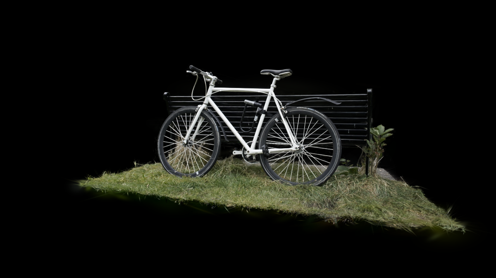
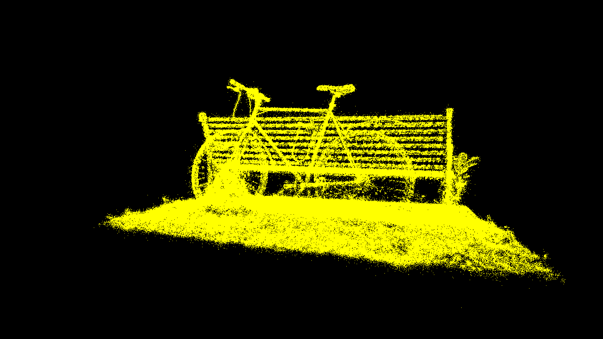

# WebGPU Gaussian Splat Viewer

**University of Pennsylvania, CIS 565: GPU Programming and Architecture — Project 5**

Zachary Kelly

[Live WebGPU demo](https://zkelly1.github.io/Project5-WebGPU-Gaussian-Splat-Viewer/) · [36-second video](https://zkelly1.github.io/Project5-WebGPU-Gaussian-Splat-Viewer/demo.webm)

This viewer loads a trained Gaussian PLY scene and its camera presets. The point
cloud renderer draws each Gaussian center as a yellow point. The Gaussian renderer
projects the shape of each Gaussian onto the screen, sorts the visible splats by
depth, and blends their colors from back to front.

## Build and run

Run from the repository root:

```powershell
npm install
npm run dev
```

Open the local address printed by Vite in a browser with WebGPU support. Load the
PLY file through `ply_file`, then load the matching camera JSON through `cam_file`.
Both files are needed before rendering starts. Scene files are provided in the
[course scene folder](https://drive.google.com/drive/folders/1Fz0QhyDU12JTsl2e7umGi5iy_V9drrIW?usp=sharing).

Use `npm run build` to check TypeScript and build the static site.

| Input | Action |
| --- | --- |
| Left mouse button and drag | Rotate the camera |
| Right mouse button and drag | Pan the camera |
| Scroll wheel | Move forward or backward |
| 0–9 | Select an available camera preset |
| renderer | Switch between point clouds and Gaussian splats |
| gaussian_multiplier | Scale the Gaussian axes; zero hides the splats |
| culling | Enable or disable the Gaussian frustum test |
| workgroup_size | Set preprocessing to 64, 128, or 256 threads |
| Save benchmark | Download timings and settings for the current view |

## Scene captures





The Gaussian image recovers the bicycle frame, bench, and grass with learned color.
The point cloud marks centers in yellow; it loses the continuous appearance of
surfaces even where the centers are dense.

The course model files are downloaded locally under `assets/scenes/` and excluded
from Git. They are also excluded from the production site build.

## Rendering

The PLY loader stores positions, opacity, rotation, scale, and spherical-harmonic
coefficients as packed half floats. The shaders unpack them before doing the math
in full precision.

Each preprocessing invocation handles one Gaussian. It transforms the center into
camera space and rejects centers outside a frustum with a 20% margin at the screen
edges. Points behind the camera are rejected even when culling is disabled.

Scale is stored in log space in the PLY file. Exponentiating it and applying the
scale slider gives the three Gaussian axes. The normalized quaternion rotates
those axes, and their covariance is transformed into camera space. A perspective
Jacobian projects that covariance into pixels. Adding 0.3 to its diagonal keeps
small splats from vanishing. The largest eigenvalue gives a three-sigma quad
radius; the inverse covariance gives the conic used by the fragment shader.

The shader evaluates spherical harmonics up to the scene's stored degree using
the direction from the camera to the Gaussian. Opacity is recovered with a sigmoid.
Visible indices and inverted positive depth keys go into the supplied radix
sorter. The visible count is copied into the indirect draw buffer, so only those
instances are drawn. Preprocessing workgroup size can change independently of the
sorter's fixed block size.

Each instance draws a four-vertex triangle strip. The fragment shader evaluates
the Gaussian at the pixel offset, discards very small alpha values, and outputs
premultiplied color. Back-to-front blending combines those contributions.

## Performance analysis

The captures use the course's `bicycle_30000.cleaned.ply` scene with 1,063,091 Gaussians and camera preset 0 at 1280 × 720. Measurements ran in the in-app Chromium 155 browser on Windows 11 Pro, with an AMD Ryzen 7 3700X and NVIDIA GeForce RTX 3070.

`Save benchmark` renders into a separate texture at the current canvas resolution.
It warms up for 30 frames, then measures 120 frames. Each sample starts before
command encoding and ends after `queue.onSubmittedWorkDone()`. This includes CPU
submission, GPU execution, and completion notification. It excludes presentation
and is not an isolated GPU timestamp measurement. The JSON includes all samples,
mean, median, p95, point count, camera pose, browser, resolution, and settings.
Camera input and the settings panel are disabled during the measurement.

For each comparison, keep the camera, resolution, and Gaussian scale fixed. Save
three runs per configuration and compare the median frame times. Record the scene
filename and GPU alongside the downloaded results.

| Comparison | Configurations |
| --- | --- |
| Point cloud vs. Gaussian | Same scene and camera, both renderers |
| Workgroup size | Gaussian preprocessing at 64, 128, and 256 threads |
| Culling | On and off, with both a broad scene view and a view facing away |
| Gaussian count | Several trained scene sizes, recording each point count |

The point cloud renderer shows centers without shape, opacity, or learned color.
Gaussian splats should fill the gaps and recover more of the scene's appearance.
A larger preprocessing group changes how invocations are scheduled, but leaves
sorting and fragment work unchanged. Which group size wins needs measurement.

Culling adds a small check during preprocessing and can reduce covariance, color,
sorting, and rasterization work when many points are off screen. A view where most
points survive may show little benefit. Increasing the Gaussian count increases
preprocessing work; the visible count and overlap also affect sorting and fragment
cost. Comparisons across different scenes include those differences, not just
point count.

### Measured results

Each value below is the median of three run medians. Each run has 30 warmup
frames and 120 measured frames. The range gives the lowest and highest run median.
The full samples are in [scene-benchmarks.json](performance/scene-benchmarks.json).

| Renderer | Points | Preprocess threads | Culling | Median ms | Run range, ms |
| --- | ---: | ---: | --- | ---: | ---: |
| Point cloud | 1,063,091 | — | — | 3.05 | 3.00–3.10 |
| Gaussian | 1,063,091 | 64 | On | 10.20 | 10.00–10.30 |
| Gaussian | 1,063,091 | 128 | On | 10.40 | 10.30–10.45 |
| Gaussian | 1,063,091 | 256 | On | 10.10 | 10.10–10.50 |
| Gaussian | 1,063,091 | 64 | Off | 10.10 | 10.10–10.10 |
| Gaussian | 1,063,091 | 128 | Off | 10.10 | 10.05–10.50 |
| Gaussian | 1,063,091 | 256 | Off | 10.15 | 10.10–10.40 |
| Gaussian | 500,000 | 256 | On | 5.90 | 5.75–6.00 |
| Gaussian | 100,000 | 256 | On | 3.50 | 3.45–3.50 |

The Gaussian renderer took about 3.3 times as long as the point cloud renderer,
but produced continuous, colored surfaces. Workgroup size had a small effect
relative to run-to-run variation. These measurements do not establish a clear
winner between 64, 128, and 256 threads. The default remains 256.

Culling was effectively neutral at this camera: 10.10 ms with it enabled and
10.15 ms disabled at 256 threads. This view contains most of the cleaned scene,
so little work is removed. That result does not imply culling is useless when
the camera faces away or much of a larger scene is outside the view.

The smaller point counts are evenly spaced samples of the original PLY records,
using record index floor(i × original_count / target_count). The camera and scale
stay fixed. Lower density also changes coverage and overlap, so this measures the
cost of those subsets, not a perfectly isolated change in invocation count.
Runtime rose from 3.50 ms at 100,000 points to 10.10 ms at 1,063,091 points. Fixed
submission and completion overhead helps explain why it did not grow in direct
proportion to point count.

The runs were sequential, with no presentation or video recording in the timed
loop. Browser scheduling and clock resolution are still part of the results.

## Validation

TypeScript and the production build pass. Chrome WebGPU checks used 4,097 synthetic
Gaussians to cross a sorting-block boundary. All three preprocessing group sizes,
with culling on and off, produced identical pixels. The benchmark returned 120
finite samples without WebGPU validation errors. Earlier checks covered reversed
depth order, zero scale, and recovery after an empty frame.

The full bicycle scene was visually checked in both renderers. The timed scene
runs reported no WebGPU validation errors. The [36-second demo](public/demo.webm)
shows point clouds, Gaussian splats, camera presets, and scale changes.

GitHub Pages is enabled with GitHub Actions. The hosted viewer was checked on
October 23, 2026 using a 100,000-point sample of the bicycle scene and its camera
presets. File loading, both renderers, camera presets, mouse rotation, and Gaussian
scale changes worked without reported WebGPU errors. The hosted video also played
at 1280 × 720. Both a clean install from the committed lockfile and the local
development dependencies pass the production build.

Pushes to `main` run **Deploy static content to Pages**. The workflow builds with
`/Project5-WebGPU-Gaussian-Splat-Viewer/` as the base path. Scene files are selected
locally through the viewer; they are not included in the deployed site.

Tile-based sorting and half-precision computation are not implemented.

## Credits

- Course starter: PLY loading, camera controls, UI, and GPU radix sort.
- [Vite](https://vitejs.dev/)
- [Tweakpane](https://tweakpane.github.io/docs/)
- [wgpu-matrix](https://github.com/greggman/wgpu-matrix)
- [Float16Array](https://github.com/petamoriken/float16)
- Shrek Shao and the [Differential Gaussian Renderer](https://github.com/graphdeco-inria/diff-gaussian-rasterization).
